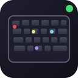

<p align="center">
  
</p>

<h1 align="center">⌨️ Keyboard-Center ⌨️</h1>

<p align="center">
  
  
  
  
  
  
  <a href="README_en.md"></a>
</p>

---

## Описание

**Keyboard-Center** — приложение для управления механическими клавиатурами **AULA** и **Ajazz**: RGB-подсветка, живые эффекты, сохранение настроек в память клавиатуры, батарея (2.4G) и диагностика протокола.

Состоит из **двух бинарников**:
- `keyboard-center` — GUI на GTK4 + Libadwaita (RGB-студия, скрин-менеджер для Ajazz, управление питанием);
- `kbc` — CLI для скриптов и быстрых операций.

Разрабатывалась и тестируется на **NixOS**. Для сборки используется **Nix Flake** (`crane`), но собрать и использовать можно и без флейка (`nix-build` / cargo / бинарник).

| | |
|---|---|
| **Язык** | Rust (edition 2021) |
| **GUI** | GTK4 + Libadwaita (`gtk4-rs`, `libadwaita-rs`) |
| **HID** | `hidapi` (через `libudev`) |
| **Сборка** | Nix Flake + `crane` |
| **Целевая ОС** | Linux (фокус — NixOS) |
| **Лицензия** | MIT |

> [!NOTE] Статус поддержки
> **AULA F75** — полностью рабочий сценарий на реальном железе (USB + 2.4G).  
> **AULA F99** и **Ajazz AK820 Pro** — драйверы написаны по ресёрчу (протокол общий с F75 / из wsclx-проектов), но физического железа для живой проверки пока нет (см. [статус устройств](#статус-устройств)).

---

## Возможности

### Реально работают на железе (F75, USB и 2.4G)

- **RGB-подсветка** — выбор цвета, яркости и скорости; живые host-эффекты (Static / Дыхание / Волна / Спектр / Риппл / Дождь / Реактивная) через direct-канал с keepalive.
- **Сохранение в память клавиатуры** — аппаратные эффекты из встроенной таблицы прошивки (`data[10]` / `led[10]`), включая яркость/скорость. Держатся **без запущенного приложения**, переживают перезапуск и отключение.
- **Выключить свет в память** — свет не загорится при старте (USB: обнуление яркости во всех слотах эффектов; 2.4G: совсем).
- **Батарея (2.4G-ресивер)** — процент заряда по каналу 0x13/0x05.
- **Автосохранение при закрытии GUI** — последний выбор эффекта/света записывается сам.
- **Выбор командного HID-интерфейса** — автоматически находит вендорский usages-page канал (hidraw), без ручного выбора.

### GUI (`keyboard-center`)

| Страница | Что делает |
|---|---|
| **Устройство** | Выбор/открытие подключённой клавиатуры, статус |
| **RGB & Light Studio** | Пресеты, режимы/яркость/скорость, «живой цвет», аппаратные эффекты, «Записать в память», «Выключить свет» |
| **Screen Manager** | Ajazz AK820 Pro: загрузка GIF/картинки на TFT-экран, превью |
| **Keymap & Fn Layer** | Переназначение клавиш, Fn-слой (AULA: протокол ремапа не ревёрснут) |
| **System & Power** | Polling rate, debounce, sleep timer, батарея, статус подключения |

### CLI (`kbc`)

```bash
kbc list                                    # список найденных устройств
kbc info 258A:010C                          # детали устройства
kbc rgb 258A:010C --mode wave --brightness 180 --speed 120   # host-эффект (USB, живёт с keepalive)
kbc rgb 3554:FA09 --mode breathing --brightness 128 --speed 30
kbc save 258A:010C --effect 0B              # аппаратный эффект в память (держится без приложения)
kbc save 3554:FA09 --effect 06              # то же для ресивера 2.4G
kbc battery 3554:FA09                       # процент заряда (2.4G; клавиатура не должна спать)
kbc time 258A:010C                          # синхронизация времени (Ajazz)
kbc set-poll 258A:010C 1000                 # polling rate
kbc set-debounce 258A:010C 4                # анти-дребезг
kbc set-sleep 258A:010C 600                 # автоотключение, c
kbc profile save ./pro.toml --device 258A:010C --name "Pro"
kbc monitor                                 # горячая замена (watch)
# --- диагностика протокола ---
kbc probe 258A:010C                         # скан интерфейсов и feature-репортов
kbc raw 258A:010C feature-get 6 520
kbc raw 258A:010C feature-send "06 84 00 00 01 00 80 00"
kbc raw 3554:FA09 output-send "13 05 00 ..."
```

---

## Поддерживаемые устройства

### VID/PID

| Устройство | Режим | VID:PID |
|---|---|---|
| **Ajazz AK820 Pro** | USB + 2.4G (один PID) | `0C45:8009` |
| | BT | `0C45:FEFE` |
| **AULA F75** | USB | `258A:004B` |
| | 2.4G | `258A:004C` |
| | BT | `258A:004D` |
| | USB (ревизия «BY Tech») | `258A:010C` |
| **AULA F75 (2.4 GHz)** | 2.4G-ресивер Compx | `3554:FA09` |
| **AULA F99** | USB | `258A:004E` |
| | 2.4G | `258A:004F` |
| | BT | `258A:0050` |

> **F99 и F75 делят один 2.4G-ресивер** `3554:FA09`. VID/PID зависят от ревизии — реальные значения смотрите через `lsusb` / `udevadm monitor`.

### Статус устройств

| Устройство | USB | 2.4G | BT | Статус |
|---|---|---|---|---|
| AULA F75 | ✅ | ✅ | ⬜ не тестировался | **есть железо, работает** |
| AULA F99 | 🟡 драйвер готов | частично (общий ресивер) | ⬜ | железа нет, протокол общий с F75 |
| Ajazz AK820 Pro | 🟡 драйвер готов | ⬜ | ⬜ | железа нет, по ресёрчу (Sonix SN32F299) |

> **Есть физически у владельца:** только **AULA F75** (USB, ревизия «BY Tech Gaming Keyboard» PID `0x010C`) + 2.4G-ресивер `3554:FA09`. Ajazz AK820 Pro и F99 физически отсутствуют — их драйверы заполняются по ресёрчу и протокольным аналогам без выдуманных команд.

---

## Установка

### Вариант 1 — NixOS (флейк в системном конфиге)

В `flake.nix` своего конфига добавьте вход:

```nix
inputs = {
  keyboard-center = {
    url = "gitlab:dark_siders/keyboard-control";
    inputs.nixpkgs.follows = "nixpkgs";   # или "flake-utils.crane.nixpkgs..."
  };
};
```

Подключите модуль и включите:

```nix
{
  imports = [
    inputs.keyboard-center.nixosModules.default
  ];

  programs.keyboard-center.enable = true;

  # Добавить пользователя в группу plugdev (доступ к hidraw без sudo)
  programs.keyboard-center.enableUserGroup = true;   # по умолчанию true
  programs.keyboard-center.enableUdevRules = true;   # по умолчанию true

  # Пользователь в группе (иначе hidraw без root не откроется):
  users.users.ваше_имя.extraGroups = [ "plugdev" ];
}
```

Собрать:

```bash
sudo nixos-rebuild switch --flake .#имя_хоста
```

Модуль ставит: бинарники `keyboard-center`/`kbc` в `environment.systemPackages`, udev-правила через `services.udev.packages`, группу `plugdev`, `.desktop`-файл и иконку.

> [!NOTE] Доступ к `/dev/hidraw`
> Если вы никогда не перелогинивались после добавления в `plugdev` — группа не применится к текущей сессии. Список активных групп: `id -nG`. Быстрый способ без перелогина: обернуть команду в `sg plugdev -c "kbc list"`.

### Вариант 2 — Home Manager (пользовательский уровень)

```nix
{ inputs, ... }:
{
  home-manager.users.ваше_имя = { ... }: {
    imports = [
      inputs.keyboard-center.homeManagerModules.default
    ];
    programs.keyboard-center.enable = true;
  };
}
```

Ставит бинарники и `.desktop`-файл на уровне пользователя. **Udev-правила при этом должен дать NixOS-модуль** (права на hidraw — системное дело).

### Вариант 3 — без флейка (NixOS / чистая сборка)

```bash
# собрать из репозитория
nix-build -E 'import (builtins.getFlake (toString ./.)) { }' -A packages.x86_64-linux.default

# либо через обёртку default.nix
nix-build
```

Результат — в `result/`, при желании установить в окружение:

```bash
# udev-правила
sudo cp 99-keyboard-center.rules /etc/udev/rules.d/
sudo udevadm control --reload-rules && sudo udevadm trigger

# бинарники (путь по образцу)
cp result/bin/* ~/.local/bin/

# .desktop + иконка
mkdir -p ~/.local/share/applications ~/.local/share/icons/hicolor/scalable/apps
cp result/share/applications/keyboard-center.desktop ~/.local/share/applications/
cp result/share/icons/hicolor/scalable/apps/keyboard-center.svg ~/.local/share/icons/hicolor/scalable/apps/
```

> [!NOTE] Доступ к hidraw без флейка
> Группа `plugdev` должна существовать и пользователь в неё входить (`sudo groupadd plugdev`, `sudo usermod -aG plugdev $USER`, перелогин). Правила выше выставляют `GROUP="plugdev" MODE="0664"`.

### Вариант 4 — разработка (cargo / dev-shell)

```bash
nix develop . --command cargo build --release
nix develop . --command cargo check --all-targets
nix develop . --command cargo test --lib
# без nix (если есть системные gtk4/libadwaita/udev)
cargo build --release
```

Готовые бинарники: `target/release/kbc`, `target/release/keyboard-center`.

---

## Работа с несколькими моделями

Сканер (`kbc list`) находит все поддерживаемые устройства сразу. Владелец держит подключёнными одновременно:

```
AULA F75 (2.4 GHz) 3554:FA09   # 2.4G-ресивер (hidraw0)
AULA F75            258A:010C   # USB, «BY Tech Gaming Keyboard»
```

> Ресивер `3554:FA09` отвечает на команды только если клавиатура **не спит на линке** — перед `kbc battery` / `kbc rgb` нажмите клавишу. Пока клавиатура спит, ресивер отвечает константным блоком на любой read.

---

## Структура проекта

```
keyboard-control/
├── AGENTS.md                 # внутренняя документация/журнал (для агента)
├── Cargo.toml                # Rust: gtk4, libadwaita, hidapi, image, clap...
├── flake.nix                 # Nix Flake: packages, nixosModules, homeManagerModules
├── default.nix               # легаси-обёртка без флейка (nix-build)
├── 99-keyboard-center.rules  # udev-правила (доступ к hidraw)
├── data/
│   ├── keyboard-center.desktop
│   ├── keyboard-center.svg   # иконка приложения
│   └── firmware/
│       ├── f75_firmware.hex  # дамп прошивки F75 (61 КБ, без модификаций)
│       └── FIRMWARE.md       # паспорт дампа
├── nix/
│   ├── nixos-module.nix      # NixOS-модуль (программы/udev/группа)
│   └── home-module.nix       # Home-Manager-модуль
└── src/
    ├── cli.rs                # CLI-бинарник `kbc`
    ├── main.rs               # GUI-бинарник `keyboard-center`
    ├── types.rs              # Color, KeyId, RgbMode, Keymap...
    ├── devices/              # trait KeyboardDevice + драйверы
    │   ├── mod.rs            # реестр VID/PID, trait, build_device
    │   ├── hid.rs            # HidBridge поверх hidapi (+выбор командного канала)
    │   ├── hidshell.rs       # raw-доступ и разведка (probe/raw)
    │   ├── scanner.rs        # сканер /dev/hidraw + hot-plug
    │   ├── ajazz_ak820.rs    # Ajazz AK820 Pro
    │   ├── aula_f75.rs       # AULA F75 (USB + 2.4G-ресивер): RGB/свет/эффекты/батарея
    │   └── aula_f99.rs       # AULA F99 (по аналогу F75, 113 LED)
    ├── gui/                  # GTK4/Libadwaita
    │   ├── app.rs            # главное окно AdwApplication
    │   ├── device_panel.rs   # выбор устройства
    │   ├── keyboard_layout.rs# визуальная клавиатура
    │   ├── rgb_studio.rs     # RGB & Light Studio
    │   ├── screen_manager.rs # Screen Manager (Ajazz)
    │   ├── keymap_editor.rs  # Keymap & Fn Layer
    │   └── settings_panel.rs # System & Power (батарея, poll rate...)
    ├── screen/converter.rs   # GIF/PNG → формат экрана TFT
    └── profiles/storage.rs   # TOML-профили + EEPROM
```

---

## Документация

| Файл | Что внутри |
|---|---|
| [data/firmware/FIRMWARE.md](data/firmware/FIRMWARE.md) | Паспорт дампа прошивки F75 (инструмент, MD5, команда) |
| AGENTS.md | Подробный журнал реверс-инжиниринга протокола (рус.) |

---

## Известные ограничения

- **Статические цвета в память не пишутся** — у AULA встроенная таблица прошивки содержит только радужные аппаратные эффекты; однотонная статика = host-эффект приложения и живёт, пока приложение открыто.
- **Батарея**: по USB канал заряда у AULA отсутствует (данные о заряде по проводу не передаются) — в GUI/CLI это честно объясняется. 2.4G — работает; BT — не тестировался.
- **AULA remap/Fn-редактор** — аппаратный протокол переназначения клавиш ещё не ревёрснут.
- **Screen Manager** — только для Ajazz AK820 Pro, железа нет — код по ресёрчу.

---

## Roadmap

- [x] AULA F75 USB: direct-RGB, host-эффекты, сохранение в память, свет выкл
- [x] AULA F75 2.4G: батарея, эффекты/яркость/скорость в память ресивера
- [x] GUI RGB-студия: пресеты, слайдеры, автосохранение при закрытии
- [ ] AULA F99 (подтверждение драйвера на железе)
- [ ] Ajazz AK820 Pro: RGB, Screen Manager (TFT), энкодер, статика в память
- [ ] Финальная документация для сборки на Fedora (без флейка)

---

## Поддержка / обратная связь

Проект персональный (автор — darkside). Проблемы можно репортить в GitLab-репозиторий: [gitlab.com/dark_siders/keyboard-control](https://gitlab.com/dark_siders/keyboard-control).

---

Maintained by darkside 🐾